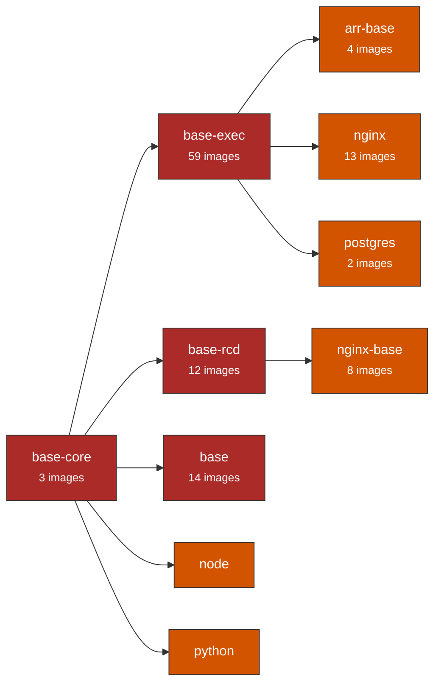

<!-- Generated by scripts/generate-architecture.py; edit the script, not this file. -->

# Architecture

How daemonless container images are layered.

## Image Layers

## Base Layer

| Image | Built on | What it gives you |
|-------|----------|-------------------|
| **base-core** | - | FreeBSD userland and pkg. No init: tool images and the other bases start here. |
| **base-exec** | base-core | One process per container. `/init` runs the setup scripts, then execs the app as `bsd`. Podman, AppJail or Kubernetes restart it. |
| **base-rcd** | base-core | Several services in one container, supervised by [rcd(8)](https://github.com/bapt/freebsd-rcd). |
| **base** | base-core | The original s6 base. Kept for images built outside daemonless; new images don't use it. |

**base-exec** is the default. The app is the container's command (`CMD`),
so its exit is the container's exit, and the runtime does the restarting,
stopping, health checks and logs. Appliances that bundle several services
(an app behind nginx, an app with its own database) use **base-rcd**, where
rcd starts the services in order and restarts any that crash.

Both run the same setup before the app starts: PUID/PGID remap the `bsd`
user, then the scripts in `/daemonless/init.d` and your own in
`/daemonless/custom.d`. See [Development](guides/development.md) for how an
image is put together.

## Intermediate Layers

| Image | Built on | Purpose |
|-------|----------|---------|
| **arr-base** | base-exec | .NET runtime for the *arr apps |
| **nginx-base** | base-rcd | nginx in front of an app (rcd runs both) |
| **nginx** | base-exec | nginx serving static sites |
| **postgres** | base-exec | PostgreSQL |
| **node** | base-core | Node.js toolchain |
| **python** | base-core | Python toolchain |

## Build Order

When an image changes, the images built on it are rebuilt:

1. **base-core** changes: rebuild everything
2. **base-exec** or **base-rcd** changes: rebuild the images on it
3. An intermediate image changes: rebuild its children only

## Images by Parent

### base-core (3)

[ffmpeg](images/ffmpeg.md), [jellyfin-ffmpeg](images/jellyfin-ffmpeg.md), [playwright](images/playwright.md)

### base-exec (59)

[actual](images/actual.md), [adguardhome](images/adguardhome.md), [adguardhome-sync](images/adguardhome-sync.md), [affine](images/affine.md), [arr-base-exec](images/arr-base-exec.md), [audiobookshelf](images/audiobookshelf.md), [authelia-server](images/authelia-server.md), [backrest](images/backrest.md), [bazarr](images/bazarr.md), [bichon](images/bichon.md), [caddy](images/caddy.md), [cloudflared](images/cloudflared.md), [emby](images/emby.md), [filebrowser-quantum](images/filebrowser-quantum.md), [grafana](images/grafana.md), [grimmory](images/grimmory.md), [haproxy](images/haproxy.md), [headscale](images/headscale.md), [home-assistant](images/home-assistant.md), [homepage](images/homepage.md), [hugo](images/hugo.md), [immich-ml](images/immich-ml.md), [immich-public-proxy](images/immich-public-proxy.md), [immich-server](images/immich-server.md), [jellyfin](images/jellyfin.md), [languagetool](images/languagetool.md), [lldap](images/lldap.md), [mariadb](images/mariadb.md), [mealie](images/mealie.md), [memcached](images/memcached.md), [n8n](images/n8n.md), [navidrome](images/navidrome.md), [nocodb](images/nocodb.md), [node-red](images/node-red.md), [openssh-server](images/openssh-server.md), [plex](images/plex.md), [qbittorrent](images/qbittorrent.md), [radicale](images/radicale.md), [redis](images/redis.md), [retroassembly](images/retroassembly.md), [sabnzbd](images/sabnzbd.md), [samba](images/samba.md), [seaweedfs](images/seaweedfs.md), [seerr](images/seerr.md), [stirling-pdf](images/stirling-pdf.md), [stump](images/stump.md), [superset](images/superset.md), [syncthing](images/syncthing.md), [tailscale](images/tailscale.md), [tautulli](images/tautulli.md), [traefik](images/traefik.md), [transmission](images/transmission.md), [ubooquity](images/ubooquity.md), [uptime-kuma](images/uptime-kuma.md), [versitygw](images/versitygw.md), [victoriametrics](images/victoriametrics.md), [vikunja](images/vikunja.md), [wagtail](images/wagtail.md), [zensical](images/zensical.md)

### base-rcd (12)

[clamav](images/clamav.md), [erpnext](images/erpnext.md), [forgejo](images/forgejo.md), [garage](images/garage.md), [gitea](images/gitea.md), [readmeabook](images/readmeabook.md), [sparkyfitness](images/sparkyfitness.md), [stalwart](images/stalwart.md), [sylve](images/sylve.md), [transmission-wireguard](images/transmission-wireguard.md), [unifi](images/unifi.md), [woodpecker](images/woodpecker.md)

### base (14)

[booklore](images/booklore.md), [bulwark-webmail](images/bulwark-webmail.md), [compose-build-probe](images/compose-build-probe.md), [erp-head](images/erp-head.md), [grimmory-gen](images/grimmory-gen.md), [opencloud-radicale](images/opencloud-radicale.md), [overseerr](images/overseerr.md), [paperless-build](images/paperless-build.md), [paperless-ngx](images/paperless-ngx.md), [papra-build](images/papra-build.md), [rmab-fix](images/rmab-fix.md), [uos-gen](images/uos-gen.md), [uos-gen-main](images/uos-gen-main.md), [vikunja-choices](images/vikunja-choices.md)

### arr-base (4)

[lidarr](images/lidarr.md), [prowlarr](images/prowlarr.md), [radarr](images/radarr.md), [sonarr](images/sonarr.md)

### nginx-base (8)

[heimdall](images/heimdall.md), [librenms](images/librenms.md), [librenms-backup-2026-09-29](images/librenms-backup-2026-09-29.md), [nextcloud](images/nextcloud.md), [onlyoffice](images/onlyoffice.md), [organizr](images/organizr.md), [smokeping](images/smokeping.md), [vaultwarden](images/vaultwarden.md)

### nginx (13)

[cadcraft](images/cadcraft.md), [designcraft](images/designcraft.md), [effectcraft](images/effectcraft.md), [figcraft](images/figcraft.md), [filmcraft](images/filmcraft.md), [gridcraft](images/gridcraft.md), [lightcraft](images/lightcraft.md), [openspeedtest](images/openspeedtest.md), [pdfcraft](images/pdfcraft.md), [photocraft](images/photocraft.md), [soundcraft](images/soundcraft.md), [vectorcraft](images/vectorcraft.md), [wordcraft](images/wordcraft.md)

### postgres (2)

[cnpg-postgres](images/cnpg-postgres.md), [immich-postgres](images/immich-postgres.md)
