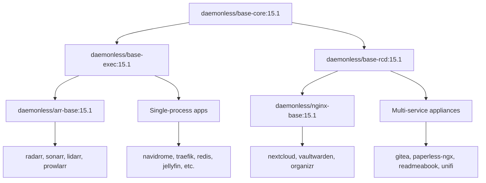

# Development

This guide covers the internal architecture, conventions, and patterns for building and contributing to daemonless containers.

## Architecture Overview

### Image Hierarchy



Pick the base by how many processes the image runs:

- **base-exec** (most images): one process. `/init` runs the setup scripts, then
  `exec`s the app as `bsd`. The app's exit is the container's exit, so podman,
  AppJail or Kubernetes restart, stop and log it. There's no supervisor inside.
- **base-rcd**: several services in one container (an app behind nginx, an app
  with its own database or workers). [rcd(8)](https://github.com/bapt/freebsd-rcd)
  runs as the container's main process and restarts any service that exits.

Both handle PUID/PGID the same way. Specialized bases add runtime dependencies:

- **arr-base** (on base-exec) - .NET runtime and libraries for *arr applications
- **nginx-base** (on base-rcd) - nginx pre-installed, run as an rcd unit next to your app

The old s6 `base` image still exists for images built outside daemonless. Don't
start new images on it. See [Architecture](../architecture.md) for the full tree.

### Repository Structure

Each image is a standalone git repo:

```
<app>/
├── Containerfile.j2        # Template for upstream binaries (:latest tag)
├── Containerfile.pkg.j2    # Template for FreeBSD packages (:pkg tags)
├── Containerfile           # Generated by dbuild generate
├── Containerfile.pkg       # Generated by dbuild generate
├── compose.yaml            # Metadata and the deployment example
├── .daemonless/config.yaml # Build variants and CIT settings
├── root/                   # Files copied into the image
│   ├── daemonless/
│   │   ├── init.d/
│   │   │   └── 20-<app>    # Setup, run as root before the app
│   │   └── libexec/
│   │       ├── <app>       # Starts the app (the image's CMD)
│   │       └── <app>.pkg   # Variant for :pkg builds (optional)
│   └── usr/local/etc/rcd.d/
│       └── <app>.ucl       # base-rcd only: one unit per service
├── README.md               # Generated
└── LICENSE
```

## Labels Reference

`dbuild generate` writes these labels into the generated `Containerfile*` from your `compose.yaml` metadata — **don't add them by hand** (see [Service Anatomy](service-anatomy.md)). This section is a reference for what each one means.

### io.daemonless.* Labels

| Label | Required | Purpose | Example |
|-------|----------|---------|---------|
| `io.daemonless.port` | Conditional | Primary listening port(s) | `"7878"`, `"80,443,8080"` |
| `io.daemonless.category` | Yes | Service classification | `"Media Management"` |
| `io.daemonless.packages` | Yes | FreeBSD packages to install | `"${PACKAGES}"` |
| `io.daemonless.volumes` | No | Suggested volume mounts | `"/movies,/downloads"` |
| `io.daemonless.upstream-url` | No | Version-check API endpoint | `"https://api.github.com/repos/Radarr/Radarr/releases/latest"` |
| `io.daemonless.upstream-jq` | No | jq filter to extract the version from that endpoint | `".tag_name"` |
| `io.daemonless.arch` | No | Supported architecture | `"amd64"` (default) |
| `io.daemonless.type` | No | Image type (base images only) | `"base"` |
| `io.daemonless.wip` | No | Work-in-progress flag | `"true"` |
| `io.daemonless.pkg-name` | No | Package name for :pkg builds | `"radarr"` |
| `io.daemonless.base` | No | Base image type | `"nginx"` |

### Upstream Version Tracking

For upstream-binary images, version status is tracked from **two** labels, both rendered from `Containerfile*.j2` ARGs:

| Label | Purpose | Example |
|-------|---------|---------|
| `io.daemonless.upstream-url` | HTTP endpoint returning version info (usually a GitHub releases API URL) | `"https://api.github.com/repos/Radarr/Radarr/releases/latest"` |
| `io.daemonless.upstream-jq` | `jq` filter applied to that response to get the version string | `".tag_name"` |

The version pipeline fetches `upstream-url` and applies `upstream-jq`. Package-based images skip these and read the version from `pkg` via `io.daemonless.pkg-name` instead. (The older `upstream-mode`/`-repo`/`-package`/`-branch`/`-sed` labels are obsolete and no longer read.)

### Category Values

- `Media Management` - radarr, sonarr, lidarr, prowlarr, overseerr
- `Media Servers` - jellyfin, plex, tautulli
- `Downloaders` - sabnzbd, transmission
- `Infrastructure` - traefik, gitea, woodpecker, tailscale
- `Databases` - redis, immich-postgres
- `Photos & Media` - immich-server, immich-ml
- `Utilities` - nextcloud, vaultwarden, mealie, n8n, smokeping

### Special Annotations

For .NET applications (arr-base derivatives):

```dockerfile
# Required in Containerfile as a label hint
LABEL org.freebsd.jail.allow.mlock="required"
```

```bash
# Required at runtime
podman run --annotation 'org.freebsd.jail.allow.mlock=true' ...
```

## The Source of Truth: `compose.yaml`

Daemonless uses a standardized `compose.yaml` file located in the root of each repository to define the image's metadata, dependencies, and configuration. **Do not manually add `io.daemonless.*` labels to your `Containerfile`**.

Instead, define your app in `compose.yaml` under the `x-daemonless` block:

```yaml
name: myapp
x-daemonless:
  title: "My App"
  category: "Utilities"
  description: "A great utility app."
  docs:
    ports:
      8080: "Web UI"
```

Then, run `dbuild generate` to automatically inject the required `io.daemonless.*` labels into your `Containerfile`s and regenerate the `README.md`.

For a quick map of what belongs in `compose.yaml`, `.daemonless/config.yaml`, and `Containerfile*.j2`, see [Service Anatomy](service-anatomy.md).

## Containerfile Patterns

### Standard Pattern (:latest)

Downloads binaries from upstream for bleeding-edge versions:

This is `Containerfile.j2`; `dbuild generate` substitutes the `{{ ... }}` values from `compose.yaml`:

```dockerfile
ARG BASE_VERSION="15.1"
FROM ghcr.io/daemonless/base-exec:${BASE_VERSION}

ARG PACKAGES="app-package dependency1 dependency2"
ARG VERSION=""
ARG UPSTREAM_URL="https://api.github.com/repos/owner/app/releases/latest"
ARG UPSTREAM_JQ=".tag_name"

# Public labels — values rendered from compose.yaml. Do NOT hard-code them;
# edit compose.yaml and run `dbuild generate`. Build/variant labels
# (packages, upstream-url, upstream-jq, version) stay as ARGs in the template.
LABEL org.opencontainers.image.title="{{ title }}" \
      org.opencontainers.image.description="{{ description }}" \
      org.opencontainers.image.source="{{ repo_url }}" \
      org.opencontainers.image.url="{{ web_url }}" \
      org.opencontainers.image.version="${VERSION}" \
      io.daemonless.category="{{ category }}" \
      io.daemonless.port="{{ ports[0].port }}" \
      io.daemonless.packages="${PACKAGES}" \
      io.daemonless.upstream-url="${UPSTREAM_URL}" \
      io.daemonless.upstream-jq="${UPSTREAM_JQ}"

# Environment
ENV HOME=/config

# Install packages
RUN pkg update && pkg install -y ${PACKAGES} && \
    pkg clean -ay && rm -rf /var/cache/pkg/*

# Download and install app (extract the version with jq, per upstream-jq)
RUN APP_VERSION=${VERSION:-$(fetch -qo - "${UPSTREAM_URL}" | jq -r "${UPSTREAM_JQ}")} && \
    fetch -qo /tmp/app.tar.gz "https://github.com/owner/app/releases/download/${APP_VERSION}/app-${APP_VERSION}.tar.gz" && \
    mkdir -p /app && \
    tar xzf /tmp/app.tar.gz -C /app --strip-components=1 && \
    rm /tmp/app.tar.gz && \
    echo "${APP_VERSION}" > /app/version

# Config directory
RUN mkdir -p /config && chown -R bsd:bsd /config /app

# Setup scripts and the launcher
COPY root/ /
RUN chmod +x /daemonless/libexec/* /daemonless/init.d/*

# /init runs this as bsd once setup is done
CMD ["/daemonless/libexec/app"]

EXPOSE {{ ports[0].port }}
VOLUME /config
```

### Package Pattern (:pkg)

Uses FreeBSD packages for stable, tested versions:

```dockerfile
ARG BASE_VERSION="15.1"
FROM ghcr.io/daemonless/base-exec:${BASE_VERSION}

ARG PKG_NAME=app
ARG PACKAGES="app"

# Labels must match Containerfile (except pkg-specific)
LABEL io.daemonless.pkg-name="${PKG_NAME}"
LABEL io.daemonless.pkg-source="containerfile"

# Install from FreeBSD packages
RUN pkg update && pkg install -y ${PACKAGES} && \
    pkg clean -ay && rm -rf /var/cache/pkg/*

# Config directory
RUN mkdir -p /config && chown -R bsd:bsd /config

# Setup scripts and the launcher; a package install may need its own
COPY root/ /
RUN chmod +x /daemonless/libexec/* /daemonless/init.d/*
RUN if [ -f /daemonless/libexec/app.pkg ]; then \
      mv /daemonless/libexec/app.pkg /daemonless/libexec/app; \
    fi

CMD ["/daemonless/libexec/app"]

EXPOSE 8080
VOLUME /config
```

### Multi-stage Pattern

For Node.js or compiled applications:

```dockerfile
ARG BASE_VERSION="15.1"
FROM ghcr.io/daemonless/base-exec:${BASE_VERSION} AS builder

# Install build dependencies
RUN pkg update && pkg install -y node npm python3 gcc ...

WORKDIR /app

# Build application
COPY package*.json ./
RUN npm ci
COPY . .
RUN npm run build
RUN npm prune --production

# Runtime stage
FROM ghcr.io/daemonless/base-exec:${BASE_VERSION}

ARG PACKAGES="node"

# Install runtime dependencies only
RUN pkg update && pkg install -y ${PACKAGES} && pkg clean -ay

# Copy built artifacts
COPY --from=builder --chown=bsd:bsd /app /app

COPY root/ /
RUN chmod +x /daemonless/libexec/* /daemonless/init.d/*

CMD ["/daemonless/libexec/app"]

EXPOSE 8080
VOLUME /config
```

## Init and Services

Every image's entrypoint is `/init`. It is a short shell script, and it does
the same setup on base-exec and base-rcd:

1. **Networking**: brings up the loopback interface (`lo0`) for health checks.
2. **Setup scripts**: runs each executable in `/daemonless/init.d/`, in name
   order. `10-usermod` comes from the base and remaps the `bsd` user to
   `PUID`/`PGID`. Your image adds its own, such as `20-<app>`.
3. **Custom scripts**: runs each executable in `/daemonless/custom.d/` (yours to
   mount, see below).
4. **Start**: on base-exec, `exec`s the image's `CMD` as `bsd`. On base-rcd,
   `exec`s rcd, which starts the units.

`/init` runs under `set -e`, so a setup script that fails stops the container,
and the error is the last thing in `podman logs`. Make a script fail when the
app can't work without it (a database migration, say), and don't let it fail
for something that doesn't matter.

**Started as another user** (`podman run --user`, Kubernetes `runAsUser`), `/init`
skips the root-only steps (`lo0`, the PUID/PGID remap) and runs the app as that
user. Setup scripts that `chown` or write outside `/config` should cope with
not being root.

### Custom Scripts

Mount your own setup scripts at `/daemonless/custom.d`. They run as root after
the image's own, before the app starts:

```bash
podman run -d \
  -v /path/to/my-scripts:/daemonless/custom.d:ro \
  ghcr.io/daemonless/radarr:latest
```

### Setup Script

`root/daemonless/init.d/20-<app>` runs as root before the app:

```bash
#!/bin/sh
set -e

# Create required directories
mkdir -p /config/data /config/logs
chown -R bsd:bsd /config

# Generate default config if missing
if [ ! -f /config/app.conf ]; then
    cp /app/app.conf.default /config/app.conf
    chown bsd:bsd /config/app.conf
fi
```

Only `export`s made in the launcher reach the app; the ones made here don't.

### Launcher (base-exec)

`root/daemonless/libexec/<app>` is the image's `CMD`. `/init` has already
dropped to `bsd` with [dsu](https://github.com/daemonless/dsu) when it runs:

```bash
#!/bin/sh
# Start app; /init has already dropped to the run user.

export HOME=/config

cd /app
exec /app/bin/app --config /config/app.conf
```

!!! tip "Always use exec"
    `exec` replaces the shell with the app, so the app gets the runtime's
    signals and its exit status is the container's.

There's no supervisor in a base-exec container: when the app exits, the
container exits, and the runtime's restart policy brings it back
(`--restart always` with podman, `restart: always` in compose). Images that must
run as root set `ENV DAEMONLESS_USER=root`.

### Units (base-rcd)

A base-rcd image runs each service as an rcd unit,
`root/usr/local/etc/rcd.d/<service>.ucl`:

```ucl
name = "app";
provides = ["app"];
type = "simple";
enable = true;
command = "/daemonless/libexec/app";
process { env_file = "/run/rcd.env"; }
restart { policy = "always"; max_retries = 0; delay = 5000; backoff = "none"; }
```

- rcd starts units as root, so the unit's launcher drops privileges itself:
  `exec dsu bsd /app/bin/app`.
- rcd starts units with an empty environment. `/init` saves the container's
  environment to `/run/rcd.env`, and `env_file` hands it to the unit.
- `max_retries = 0` means restart forever. With rcd's default of 5, a unit that
  crashes for the fifth time stays down while the container keeps running.
- `sig_stop` sets the signal that stops a unit, for apps that want something
  other than `TERM` (nginx: `QUIT`, PostgreSQL: `INT`).
- rcd stops units one at a time, and `/etc/rcd.conf` keeps the total under
  podman's 10 second stop timeout.

Unit output goes to the container's stdout, so `podman logs` shows every
service.

!!! warning "`cd` after `dsu` does nothing"
    `dsu bsd cd /app cmd` runs `/usr/bin/cd`, which exits without running
    `cmd`. Change directory first: `cd /app && exec dsu bsd cmd`.

### Readiness

Neither base has a readiness protocol. Give the image a health check instead
(`HEALTHCHECK_URL` and `/healthz`): podman, fjord and dbuild's tests poll it.

## Environment Variables

### Base Container

| Variable | Default | Purpose |
|----------|---------|---------|
| `PUID` | `1000` | User ID for bsd user |
| `PGID` | `1000` | Group ID for bsd group |
| `TZ` | `UTC` | Timezone |

### Logs

Everything an image prints goes to the container's stdout and stderr: the
`[init]` lines, the setup scripts, the app, and on base-rcd every unit.

```bash
# Live
podman logs -f radarr

# Application log files, where the app writes its own
ls /data/config/radarr/logs/
```

The images don't write their own log files. Rotation and retention are the
runtime's job (podman's `--log-opt max-size`, for example).

### .NET Applications

| Variable | Default | Purpose |
|----------|---------|---------|
| `CLR_OPENSSL_VERSION_OVERRIDE` | `35` | OpenSSL version hint |
| `DOTNET_SYSTEM_NET_DISABLEIPV6` | `1` | Disable IPv6 in .NET |
| `HOME` | `/config` | .NET home directory |

## Build System

The Daemonless project uses [dbuild](dbuild/index.md) as its primary build engine. `dbuild` handles the full lifecycle of an image, from initial build to integration testing and publishing.

### Local Building

To build an image locally, navigate to the image repository and use `dbuild`:

```bash
cd daemonless/radarr

# Build all variants (latest, pkg, pkg-latest)
dbuild build

# Build a specific variant
dbuild build --variant latest

# Build and run tests
dbuild build --variant latest
dbuild test --variant latest
```

### CI/CD Pipeline

Standard `.github/workflows/build.yaml` for a new image repository:

```yaml
name: Build and Publish
on:
  push:
    branches: [ "main" ]
jobs:
  build:
    runs-on: self-hosted
    steps:
      - uses: actions/checkout@v4
      - name: Build and Test
        run: dbuild ci-run --prepare
```

!!! info "Legacy CI (Woodpecker as Plan-B)"
    We previously used Woodpecker CI before migrating to GitHub Actions. Woodpecker serves as our "Plan B" if GHA ever goes down. We still maintain the configuration capability, but we don't currently use it for active builds.

The `dbuild ci-run` command handles environment preparation, multi-variant building, CIT testing, pushing to the registry, and SBOM generation.

## Adding a New Image

### 1. Create Repository

```bash
mkdir myapp && cd myapp
git init
```

### 2. Initialize with dbuild

```bash
dbuild init --github
```

This creates a starter `compose.yaml`, `Containerfile`, `.daemonless/config.yaml`, and `.github/workflows/build.yaml` (use `--woodpecker` instead if you need to scaffold the fallback pipeline).

#### Initializing from a FreeBSD Port

If the app you're packaging already has a FreeBSD port, point `dbuild init` at it instead of starting from a blank template. It queries the port's Makefile (title, description, license, category, runtime deps) and pre-fills `.daemonless/config.yaml` and `compose.yaml` for you:

```bash
dbuild init --freebsd-port www/forgejo --name forgejo --title Forgejo --variants latest,pkg,pkg-latest
```

Requires a local ports tree checkout (`$PORTSDIR`, default `/usr/ports`).

##### FLAVORS

Some ports build multiple package variants via FreeBSD's `FLAVORS` mechanism (e.g. `editors/joe`'s `tiny`/`x11` flavors). Pass `--flavors` to scaffold one pkg-type variant tag per flavor, each pointing at that flavor's own resolved package name:

```bash
dbuild init --freebsd-port editors/joe --name joe --variants pkg,pkg-latest --flavors tiny,x11
```

This generates `pkg-tiny`, `pkg-x11`, `pkg-latest-tiny`, and `pkg-latest-x11` variant tags (each with its own `pkg_name:` in `.daemonless/config.yaml`) — flavors only apply to pkg-type (`Containerfile.pkg`) variants, since `FLAVORS` is a FreeBSD packaging concept with no equivalent for upstream-source builds. `--flavors` requires `--freebsd-port`, and `dbuild init` aborts without scaffolding anything if a requested flavor doesn't exist on that port.

### 3. Configure Metadata & Assets

Edit `compose.yaml` to set your app's title, ports, and category. Then, fetch the visual assets and generate the documentation:

```bash
# Fetch the app's logo (Used in the daemonless.io app grid and README headers)
dbuild logo

# Capture a UI screenshot (Used on the website to showcase the app)
dbuild screenshot

# Capture a baseline screenshot (Used for CIT visual regression tests)
dbuild baseline

# Sync metadata and generate README.md
dbuild generate
```

This automatically injects the required `io.daemonless.*` labels into your Containerfiles and builds a rich `README.md` using your fetched assets.

### 4. Create Service Files

```bash
mkdir -p root/daemonless/libexec root/daemonless/init.d
```

### 5. Test Locally

```bash
# Build and test
dbuild build
dbuild test
```

### 6. Push to Registry

```bash
git add .
git commit -m "Initial myapp container"
git remote add origin git@github.com:daemonless/myapp.git
git push -u origin main
```

## Conventions Checklist

- [ ] Use `fetch` instead of `curl` (included in FreeBSD base)
- [ ] Clean pkg cache: `pkg clean -ay && rm -rf /var/cache/pkg/*`
- [ ] Set ownership: `chown -R bsd:bsd /config /app`
- [ ] Make scripts executable: `chmod +x /daemonless/libexec/* /daemonless/init.d/*`
- [ ] base-exec: `CMD` is the launcher, which `exec`s the app
- [ ] base-rcd: each unit's launcher drops to `bsd` with `exec dsu bsd ...`
- [ ] Create /config directory and set as VOLUME
- [ ] Run `dbuild generate` to sync `compose.yaml` metadata to Containerfiles
- [ ] Use ARG for BASE_VERSION, PACKAGES, VERSION
- [ ] Include `upstream_url` in `compose.yaml` for version detection
- [ ] Add `io.daemonless.wip="true"` for incomplete images

## Troubleshooting

### .NET Apps Won't Start

Ensure `ocijail` 0.5.0+ is installed and the annotation is set:

```bash
pkg install ocijail
podman run --annotation 'org.freebsd.jail.allow.mlock=true' ...
```

See [ocijail Native Support](ocijail-patch.md) for details.

### Permission Denied

Check PUID/PGID match host user:

```bash
podman run -e PUID=$(id -u) -e PGID=$(id -g) ...
```

### Service Not Starting

Check the init output and the app's last words:

```bash
podman logs myapp 2>&1 | grep -A5 "\[init\]"
podman logs --tail 50 myapp
```

A setup script that fails stops the container before the app starts; its error
is the last thing in the log. On base-rcd, `rcctl status` lists the units:

```bash
podman exec myapp rcctl status
```

### Build Fails on pkg install

Check package name exists:

```bash
pkg search myapp
pkg rquery '%n %v' myapp
```
