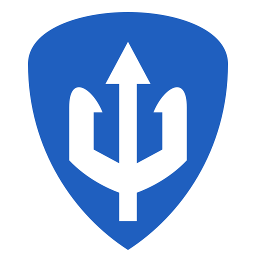
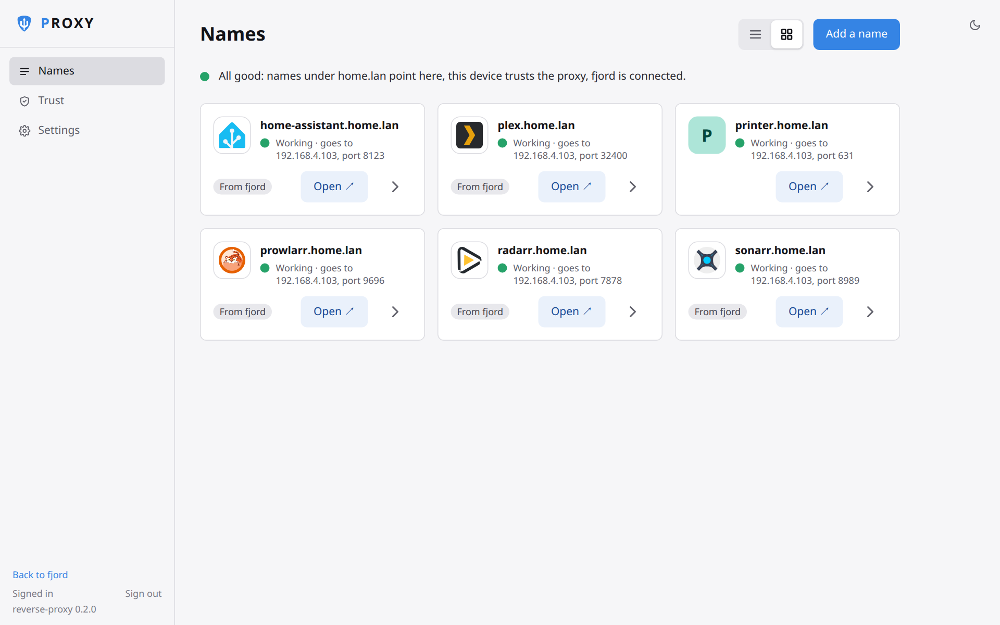
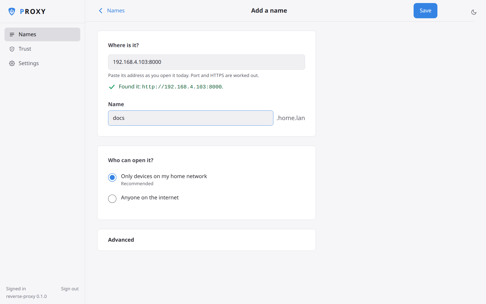
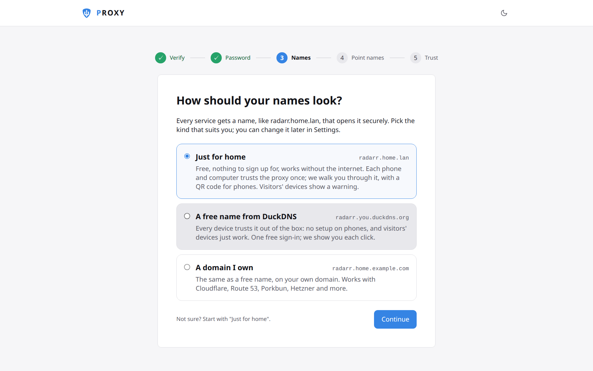
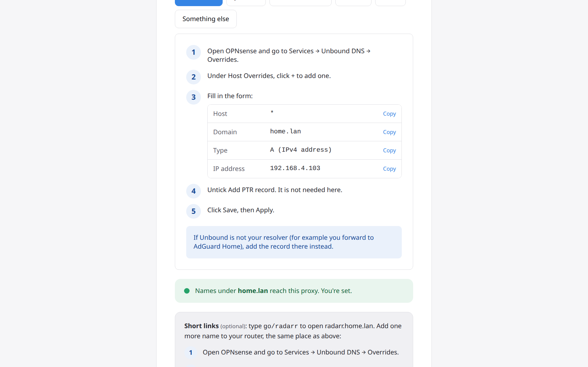
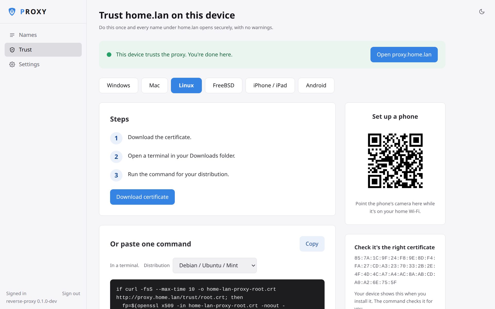
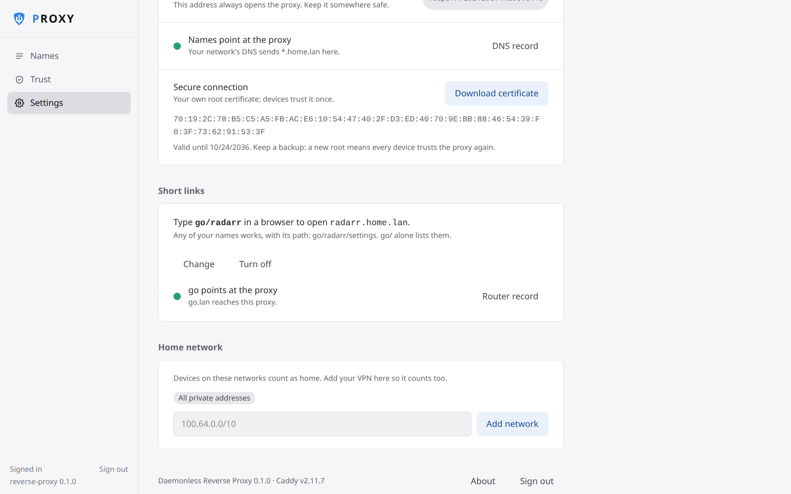

<div class="rp-hero">
  <div class="rp-hero-logo">
    
  </div>

  <div class="rp-platform-bar" aria-label="Supported operating systems and architectures">
    <span class="rp-os-pill rp-os-pill--freebsd">
      <svg xmlns="http://www.w3.org/2000/svg" viewBox="0 0 24 24" fill="none" stroke="currentColor" stroke-width="2" stroke-linecap="round" stroke-linejoin="round"><rect x="2" y="2" width="20" height="8" rx="2" ry="2"/><rect x="2" y="14" width="20" height="8" rx="2" ry="2"/><line x1="6" y1="6" x2="6.01" y2="6"/><line x1="6" y1="18" x2="6.01" y2="18"/></svg>
      FreeBSD
      <span class="rp-os-arch">amd64 · arm64</span>
    </span>
    <span class="rp-os-pill rp-os-pill--linux">
      <svg xmlns="http://www.w3.org/2000/svg" viewBox="0 0 24 24" fill="none" stroke="currentColor" stroke-width="2" stroke-linecap="round" stroke-linejoin="round"><polyline points="4 17 10 11 4 5"/><line x1="12" y1="19" x2="20" y2="19"/></svg>
      Linux
      <span class="rp-os-arch">amd64 · arm64</span>
    </span>
  </div>

  <h1>Reverse Proxy</h1>

  <div class="rp-url-transform" aria-label="From IP and port with browser warning to HTTPS hostname">
    <span class="rp-url-chip rp-url-chip--before">
      <svg xmlns="http://www.w3.org/2000/svg" viewBox="0 0 24 24" fill="none" stroke="currentColor" stroke-width="2.2" stroke-linecap="round" stroke-linejoin="round"><path d="m21.73 18-8-14a2 2 0 0 0-3.48 0l-8 14A2 2 0 0 0 4 21h16a2 2 0 0 0 1.73-3Z"/><line x1="12" y1="9" x2="12" y2="13"/><line x1="12" y1="17" x2="12.01" y2="17"/></svg>
      192.168.1.20:7878
    </span>
    <span class="rp-url-arrow" aria-hidden="true">→</span>
    <span class="rp-url-chip rp-url-chip--after">
      <svg xmlns="http://www.w3.org/2000/svg" viewBox="0 0 24 24" fill="none" stroke="currentColor" stroke-width="2.2" stroke-linecap="round" stroke-linejoin="round"><rect x="3" y="11" width="18" height="11" rx="2" ry="2"/><path d="M7 11V7a5 5 0 0 1 10 0v4"/></svg>
      https://radarr.home.lan
    </span>
  </div>

  <p class="rp-hero-subtitle">Every app on your network gets a real name with HTTPS.</p>
  <p class="rp-hero-tagline">Type <code>radarr.home.lan</code> or <code>radarr.example.com</code> and get a trusted padlock instead of a browser warning. Set it up step by step in a browser, with no config files to write. <a href="https://caddyserver.com">Caddy</a> underneath, managed for you.</p>

  <div class="rp-hero-buttons">
    <a href="#install" class="md-button md-button--primary">Install</a>
    <a href="setup/" class="md-button">Setup guide</a>
    <a href="#tour" class="md-button">Explore the interface</a>
    <a href="../images/reverse-proxy/" class="md-button">Compose and image spec</a>
    <a href="https://github.com/daemonless/reverse-proxy-src" class="md-button">GitHub</a>
  </div>

  <div class="rp-window-frame">
    <div class="rp-window-header">
      <span class="rp-window-dot red"></span>
      <span class="rp-window-dot yellow"></span>
      <span class="rp-window-dot green"></span>
      <span class="rp-window-title">
        <svg xmlns="http://www.w3.org/2000/svg" viewBox="0 0 24 24" fill="none" stroke="currentColor" stroke-width="2.2" stroke-linecap="round" stroke-linejoin="round"><rect x="3" y="11" width="18" height="11" rx="2" ry="2"/><path d="M7 11V7a5 5 0 0 1 10 0v4"/></svg>
        https://proxy.home.lan
      </span>
      <span class="rp-window-badge">Adding a name and opening over HTTPS</span>
    </div>
    <div class="rp-demo" role="img" aria-label="Daemonless Reverse Proxy demo: adding a service by pasting its address and opening its new HTTPS name">
      <video class="rp-demo-dark" muted loop playsinline preload="metadata" poster="demo-dark.jpg">
        <source src="demo-dark.webm" type="video/webm">
        <source src="demo-dark.mp4" type="video/mp4">
      </video>
      <video class="rp-demo-light" muted loop playsinline preload="metadata" poster="demo-light.jpg">
        <source src="demo-light.webm" type="video/webm">
        <source src="demo-light.mp4" type="video/mp4">
      </video>
    </div>
  </div>
</div>

<div class="rp-section">
  <div class="rp-section-head">
    <span class="rp-eyebrow">Multi-OS · Multi-arch</span>
    <h2>One image across FreeBSD and Linux</h2>
    <p>Pull <code>ghcr.io/daemonless/reverse-proxy:latest</code> on <code>amd64</code> or <code>arm64</code>. Same web UI, same API, and same encrypted backup file on every host.</p>
  </div>

  <div class="rp-platform-grid">
    <div class="rp-platform-card rp-platform-card--freebsd">
      <div class="rp-platform-card__top">
        <h3 class="rp-platform-card__title">
          <svg xmlns="http://www.w3.org/2000/svg" viewBox="0 0 24 24" fill="none" stroke="currentColor" stroke-width="2" stroke-linecap="round" stroke-linejoin="round"><rect x="2" y="2" width="20" height="8" rx="2" ry="2"/><rect x="2" y="14" width="20" height="8" rx="2" ry="2"/><line x1="6" y1="6" x2="6.01" y2="6"/><line x1="6" y1="18" x2="6.01" y2="18"/></svg>
          FreeBSD
        </h3>
        <div class="rp-arch-chips">
          <span class="rp-arch-chip">amd64</span>
          <span class="rp-arch-chip">arm64</span>
        </div>
      </div>
      <p>Runs natively on FreeBSD inside a jail. Caddy and the Go and Svelte admin process are compiled for FreeBSD <code>amd64</code> and <code>arm64</code>.</p>
      <div class="rp-runtime-row">
        <span class="rp-runtime-tag">Podman + ocijail</span>
        <span class="rp-runtime-tag">fjord</span>
      </div>
    </div>

    <div class="rp-platform-card rp-platform-card--linux">
      <div class="rp-platform-card__top">
        <h3 class="rp-platform-card__title">
          <svg xmlns="http://www.w3.org/2000/svg" viewBox="0 0 24 24" fill="none" stroke="currentColor" stroke-width="2" stroke-linecap="round" stroke-linejoin="round"><polyline points="4 17 10 11 4 5"/><line x1="12" y1="19" x2="20" y2="19"/></svg>
          Linux
        </h3>
        <div class="rp-arch-chips">
          <span class="rp-arch-chip">amd64</span>
          <span class="rp-arch-chip">arm64</span>
        </div>
      </div>
      <p>Built on Linux (Alpine) for Linux <code>amd64</code> and <code>arm64</code>, running the same Caddy binary, admin UI, API, and label watcher.</p>
      <div class="rp-runtime-row">
        <span class="rp-runtime-tag">Podman</span>
        <span class="rp-runtime-tag">fjord</span>
        <span class="rp-runtime-tag">SELinux support</span>
      </div>
    </div>
  </div>
</div>

<div class="rp-section">
  <div class="rp-section-head">
    <span class="rp-eyebrow">Certificates</span>
    <h2>Three ways to name your apps</h2>
    <p>Pick how your names should look during first-run setup. Every app gets automatic HTTPS whether your network stays offline or uses your own domain.</p>
  </div>

  <div class="rp-modes">
    <div class="rp-mode-card">
      <span class="rp-mode-index">01 / Just for home</span>
      <h3>Private home ending</h3>
      <span class="rp-mode-domain">radarr.home.lan</span>
      <p>Free and works without the internet. The proxy creates its own root certificate, restricted to your chosen ending so it can never vouch for any other site, and walks phones and computers through trusting it once with a QR code.</p>
    </div>

    <div class="rp-mode-card">
      <span class="rp-mode-index">02 / Free public name</span>
      <h3>Built-in DuckDNS</h3>
      <span class="rp-mode-domain">radarr.you.duckdns.org</span>
      <p>Pick DuckDNS in setup and paste your token. The proxy obtains and renews a Let's Encrypt wildcard certificate automatically, with nothing to install on any phone or computer, while keeping names private to your home network by default.</p>
    </div>

    <div class="rp-mode-card">
      <span class="rp-mode-index">03 / Your own domain</span>
      <h3>Wildcard DNS-01</h3>
      <span class="rp-mode-domain">radarr.example.com</span>
      <p>Connect Cloudflare, Route 53, DuckDNS, deSEC, Porkbun, Hetzner, OVH, Gandi, RFC 2136, or acme-dns. Tokens are tested on Let's Encrypt's staging service first, and one wildcard covers every app so names do not appear in public certificate logs one by one.</p>
    </div>
  </div>
</div>

<div class="rp-section rp-section--tight" id="tour">
  <div class="rp-section-head">
    <span class="rp-eyebrow">Web interface</span>
    <h2>Managed in one place</h2>
    <p>From first-run router DNS steps to 1-minute uptime checks, short links, and encrypted backups, every part of running Caddy is handled in the browser.</p>
  </div>
</div>

=== ":material-shield-check-outline: Names and uptime"

    <div class="rp-window-frame">
      <div class="rp-window-header">
        <span class="rp-window-dot red"></span>
        <span class="rp-window-dot yellow"></span>
        <span class="rp-window-dot green"></span>
        <span class="rp-window-title">
          <svg xmlns="http://www.w3.org/2000/svg" viewBox="0 0 24 24" fill="none" stroke="currentColor" stroke-width="2.2" stroke-linecap="round" stroke-linejoin="round"><rect x="3" y="11" width="18" height="11" rx="2" ry="2"/><path d="M7 11V7a5 5 0 0 1 10 0v4"/></svg>
          Reverse Proxy: Names
        </span>
        <span class="rp-window-badge">Click to zoom</span>
      </div>
      <a href="01-names.png" class="glightbox" data-gallery="rp-tour">
        
      </a>
    </div>

    <div class="rp-feature-strip">
      <div class="rp-feature-card">
        <h4>
          <svg xmlns="http://www.w3.org/2000/svg" viewBox="0 0 24 24" fill="none" stroke="currentColor" stroke-width="2" stroke-linecap="round" stroke-linejoin="round"><path d="M22 12h-4l-3 9L9 3l-3 9H2"/></svg>
          1-minute uptime and history
        </h4>
        <p>Every name is checked once a minute. View 24-hour status bars on the Names page and 90-day uptime with outage logs on each app.</p>
      </div>
      <div class="rp-feature-card">
        <h4>
          <svg xmlns="http://www.w3.org/2000/svg" viewBox="0 0 24 24" fill="none" stroke="currentColor" stroke-width="2" stroke-linecap="round" stroke-linejoin="round"><path d="M18 8A6 6 0 0 0 6 8c0 7-3 9-3 9h18s-3-2-3-9"/><path d="M13.73 21a2 2 0 0 1-3.46 0"/></svg>
          ntfy and webhook alerts
        </h4>
        <p>Send a message to <code>ntfy</code> or a webhook when a service fails two checks in a row, and again when it comes back.</p>
      </div>
      <div class="rp-feature-card">
        <h4>
          <svg xmlns="http://www.w3.org/2000/svg" viewBox="0 0 24 24" fill="none" stroke="currentColor" stroke-width="2" stroke-linecap="round" stroke-linejoin="round"><path d="M10 13a5 5 0 0 0 7.54.54l3-3a5 5 0 0 0-7.07-7.07l-1.72 1.71"/><path d="M14 11a5 5 0 0 0-7.54-.54l-3 3a5 5 0 0 0 7.07 7.07l1.71-1.71"/></svg>
          <code>go/radarr</code> short links
        </h4>
        <p>Type <code>go/radarr</code> in any browser on your network to open <code>radarr.&lt;your domain&gt;</code>, or open <code>go/</code> for the proxy's Names page.</p>
      </div>
    </div>

=== ":material-plus-circle-outline: Add a name"

    <div class="rp-window-frame">
      <div class="rp-window-header">
        <span class="rp-window-dot red"></span>
        <span class="rp-window-dot yellow"></span>
        <span class="rp-window-dot green"></span>
        <span class="rp-window-title">
          <svg xmlns="http://www.w3.org/2000/svg" viewBox="0 0 24 24" fill="none" stroke="currentColor" stroke-width="2.2" stroke-linecap="round" stroke-linejoin="round"><rect x="3" y="11" width="18" height="11" rx="2" ry="2"/><path d="M7 11V7a5 5 0 0 1 10 0v4"/></svg>
          Reverse Proxy: Add a name
        </span>
        <span class="rp-window-badge">Click to zoom</span>
      </div>
      <a href="02-add-a-name.png" class="glightbox" data-gallery="rp-tour">
        
      </a>
    </div>

    <div class="rp-feature-strip">
      <div class="rp-feature-card">
        <h4>
          <svg xmlns="http://www.w3.org/2000/svg" viewBox="0 0 24 24" fill="none" stroke="currentColor" stroke-width="2" stroke-linecap="round" stroke-linejoin="round"><circle cx="11" cy="11" r="8"/><line x1="21" y1="21" x2="16.65" y2="16.65"/></svg>
          Upstream probing
        </h4>
        <p>Paste the address you open today. The proxy checks whether the app speaks HTTP or HTTPS, confirms that it answers, and handles self-signed upstream certificates.</p>
      </div>
      <div class="rp-feature-card">
        <h4>
          <svg xmlns="http://www.w3.org/2000/svg" viewBox="0 0 24 24" fill="none" stroke="currentColor" stroke-width="2" stroke-linecap="round" stroke-linejoin="round"><path d="M12 22s8-4 8-10V5l-8-3-8 3v7c0 6 8 10 8 10z"/></svg>
          Home-only by default
        </h4>
        <p>Names open only on your home network and any VPN subnets you add, such as Tailscale, unless you open one to the internet. Outsiders get nothing back.</p>
      </div>
      <div class="rp-feature-card">
        <h4>
          <svg xmlns="http://www.w3.org/2000/svg" viewBox="0 0 24 24" fill="none" stroke="currentColor" stroke-width="2" stroke-linecap="round" stroke-linejoin="round"><polyline points="16 3 21 3 21 8"/><line x1="4" y1="20" x2="21" y2="3"/><polyline points="21 16 21 21 16 21"/><line x1="15" y1="15" x2="21" y2="21"/><line x1="4" y1="4" x2="9" y2="9"/></svg>
          Strict apps and extra names
        </h4>
        <p>Give one app multiple names, forward to HTTPS backends, or send the backend's own address in <code>Origin</code> and <code>Referer</code> headers for apps like UniFi.</p>
      </div>
    </div>

=== ":material-auto-fix: Guided setup and router DNS"

    <div class="rp-shot-pair">
      <div class="rp-window-frame">
        <div class="rp-window-header">
          <span class="rp-window-dot red"></span>
          <span class="rp-window-dot yellow"></span>
          <span class="rp-window-dot green"></span>
          <span class="rp-window-title">Step 1: How names look</span>
          <span class="rp-window-badge">Click to zoom</span>
        </div>
        <a href="03-how-names-look.png" class="glightbox" data-gallery="rp-tour">
          
        </a>
      </div>
      <div class="rp-window-frame">
        <div class="rp-window-header">
          <span class="rp-window-dot red"></span>
          <span class="rp-window-dot yellow"></span>
          <span class="rp-window-dot green"></span>
          <span class="rp-window-title">Step 2: Point names at this proxy</span>
          <span class="rp-window-badge">Click to zoom</span>
        </div>
        <a href="04-point-names.png" class="glightbox" data-gallery="rp-tour">
          
        </a>
      </div>
    </div>

    <div class="rp-feature-strip">
      <div class="rp-feature-card">
        <h4>
          <svg xmlns="http://www.w3.org/2000/svg" viewBox="0 0 24 24" fill="none" stroke="currentColor" stroke-width="2" stroke-linecap="round" stroke-linejoin="round"><rect x="2" y="3" width="20" height="14" rx="2" ry="2"/><line x1="8" y1="21" x2="16" y2="21"/><line x1="12" y1="17" x2="12" y2="21"/></svg>
          Walks through your router
        </h4>
        <p>Copy-paste DNS records for OPNsense, pfSense, UniFi, AdGuard Home, Pi-hole, and others, turning green once queries reach the proxy.</p>
      </div>
      <div class="rp-feature-card">
        <h4>
          <svg xmlns="http://www.w3.org/2000/svg" viewBox="0 0 24 24" fill="none" stroke="currentColor" stroke-width="2" stroke-linecap="round" stroke-linejoin="round"><circle cx="12" cy="12" r="10"/><line x1="12" y1="16" x2="12" y2="12"/><line x1="12" y1="8" x2="12.01" y2="8"/></svg>
          Plain-word diagnostics
        </h4>
        <p>When a certificate or DNS check fails, the proxy explains why in plain words, such as a rejected token, missing DNS record, or rate limit, and how to fix it.</p>
      </div>
      <div class="rp-feature-card">
        <h4>
          <svg xmlns="http://www.w3.org/2000/svg" viewBox="0 0 24 24" fill="none" stroke="currentColor" stroke-width="2" stroke-linecap="round" stroke-linejoin="round"><polyline points="9 14 4 9 9 4"/><path d="M20 20v-7a4 4 0 0 0-4-4H4"/></svg>
          Safe config updates and Undo
        </h4>
        <p>Caddy's configuration is generated from one state file; anything Caddy rejects leaves the running config in place, and deleted names have one-click Undo.</p>
      </div>
    </div>

=== ":material-qrcode-scan: Device trust"

    <div class="rp-window-frame">
      <div class="rp-window-header">
        <span class="rp-window-dot red"></span>
        <span class="rp-window-dot yellow"></span>
        <span class="rp-window-dot green"></span>
        <span class="rp-window-title">
          <svg xmlns="http://www.w3.org/2000/svg" viewBox="0 0 24 24" fill="none" stroke="currentColor" stroke-width="2.2" stroke-linecap="round" stroke-linejoin="round"><rect x="3" y="11" width="18" height="11" rx="2" ry="2"/><path d="M7 11V7a5 5 0 0 1 10 0v4"/></svg>
          Reverse Proxy: Trust this proxy
        </span>
        <span class="rp-window-badge">Click to zoom</span>
      </div>
      <a href="05-trust.png" class="glightbox" data-gallery="rp-tour">
        
      </a>
    </div>

    <div class="rp-feature-strip">
      <div class="rp-feature-card">
        <h4>
          <svg xmlns="http://www.w3.org/2000/svg" viewBox="0 0 24 24" fill="none" stroke="currentColor" stroke-width="2" stroke-linecap="round" stroke-linejoin="round"><rect x="5" y="2" width="14" height="20" rx="2" ry="2"/><line x1="12" y1="18" x2="12.01" y2="18"/></svg>
          QR code for phones and tablets
        </h4>
        <p>Scan once from an iPhone, iPad, or Android device to install the home certificate, guided step by step with OS menu paths.</p>
      </div>
      <div class="rp-feature-card">
        <h4>
          <svg xmlns="http://www.w3.org/2000/svg" viewBox="0 0 24 24" fill="none" stroke="currentColor" stroke-width="2" stroke-linecap="round" stroke-linejoin="round"><polyline points="4 17 10 11 4 5"/><line x1="12" y1="19" x2="20" y2="19"/></svg>
          Desktop and server operating systems
        </h4>
        <p>Trust instructions for macOS, Windows, Linux, and FreeBSD so browsers and CLI tools accept your <code>*.home.lan</code> names.</p>
      </div>
      <div class="rp-feature-card">
        <h4>
          <svg xmlns="http://www.w3.org/2000/svg" viewBox="0 0 24 24" fill="none" stroke="currentColor" stroke-width="2" stroke-linecap="round" stroke-linejoin="round"><rect x="3" y="11" width="18" height="11" rx="2" ry="2"/><path d="M7 11V7a5 5 0 0 1 10 0v4"/></svg>
          Scoped root authority
        </h4>
        <p>Uses X.509 name constraints limited to your home ending, so your devices trust it for <code>*.home.lan</code> and nothing else on the internet.</p>
      </div>
    </div>

=== ":material-cog-outline: Settings and backups"

    <div class="rp-window-frame">
      <div class="rp-window-header">
        <span class="rp-window-dot red"></span>
        <span class="rp-window-dot yellow"></span>
        <span class="rp-window-dot green"></span>
        <span class="rp-window-title">
          <svg xmlns="http://www.w3.org/2000/svg" viewBox="0 0 24 24" fill="none" stroke="currentColor" stroke-width="2.2" stroke-linecap="round" stroke-linejoin="round"><rect x="3" y="11" width="18" height="11" rx="2" ry="2"/><path d="M7 11V7a5 5 0 0 1 10 0v4"/></svg>
          Reverse Proxy: Settings
        </span>
        <span class="rp-window-badge">Click to zoom</span>
      </div>
      <a href="06-settings.png" class="glightbox" data-gallery="rp-tour">
        
      </a>
    </div>

    <div class="rp-feature-strip">
      <div class="rp-feature-card">
        <h4>
          <svg xmlns="http://www.w3.org/2000/svg" viewBox="0 0 24 24" fill="none" stroke="currentColor" stroke-width="2" stroke-linecap="round" stroke-linejoin="round"><circle cx="12" cy="12" r="10"/><line x1="2" y1="12" x2="22" y2="12"/><path d="M12 2a15.3 15.3 0 0 1 4 10 15.3 15.3 0 0 1-4 10 15.3 15.3 0 0 1-4-10 15.3 15.3 0 0 1 4-10z"/></svg>
          Multi-VLAN and VPN support
        </h4>
        <p>Add VPN subnets such as Tailscale (<code>100.64.0.0/10</code>) as home, and pick which attached VLANs may open home-only names while still reaching apps on other VLANs.</p>
      </div>
      <div class="rp-feature-card">
        <h4>
          <svg xmlns="http://www.w3.org/2000/svg" viewBox="0 0 24 24" fill="none" stroke="currentColor" stroke-width="2" stroke-linecap="round" stroke-linejoin="round"><path d="M21 15v4a2 2 0 0 1-2 2H5a2 2 0 0 1-2-2v-4"/><polyline points="7 10 12 15 17 10"/><line x1="12" y1="15" x2="12" y2="3"/></svg>
          One backup file
        </h4>
        <p>Download one encrypted backup holding names, settings, DNS tokens, and the root CA. Restore on a new host without re-trusting your devices.</p>
      </div>
      <div class="rp-feature-card">
        <h4>
          <svg xmlns="http://www.w3.org/2000/svg" viewBox="0 0 24 24" fill="none" stroke="currentColor" stroke-width="2" stroke-linecap="round" stroke-linejoin="round"><path d="M12 22s8-4 8-10V5l-8-3-8 3v7c0 6 8 10 8 10z"/></svg>
          Privilege-separated processes
        </h4>
        <p>Only Caddy runs as root to bind ports <code>80</code> and <code>443</code>. The web UI and API run unprivileged as <code>PUID</code>/<code>PGID</code> and talk over Unix sockets.</p>
      </div>
    </div>

<div class="rp-section rp-section--tight">
  <div class="rp-section-head">
    <span class="rp-eyebrow">Automation</span>
    <h2>fjord, container labels, and API</h2>
    <p>Add names in the browser, or let your container manager, compose labels, and scripts register services automatically.</p>
  </div>

  <div class="rp-auto-grid">
    <div class="rp-auto-card">
      <div class="rp-auto-card__head">
        <h3>Pairs with fjord</h3>
      </div>
      <p>Install Reverse Proxy from <a href="https://fjord.daemonless.io">fjord</a> and the two pair automatically. fjord names your stacks in one click and updates each name whenever a container moves to a new address. Additional hosts link with a pairing link.</p>
    </div>

    <div class="rp-auto-card">
      <div class="rp-auto-card__head">
        <h3>Container labels</h3>
      </div>
      <p>Add <code>io.daemonless.proxy=true</code> to a container, the way Traefik users expect, and it gets an HTTPS name via <code>/var/run/podman</code>. A stopped container keeps its name, shown as down; a removed one keeps it for 7 days. A switch in Settings turns this off.</p>
    </div>

    <div class="rp-auto-card">
      <div class="rp-auto-card__head">
        <h3>REST API and CLI</h3>
      </div>
      <p>Create scoped bearer keys per script or app against the OpenAPI reference (<code>/api/v1/openapi.json</code>), or manage names from the host shell with <code>podman exec reverse-proxy reverse-proxy hosts</code>.</p>
    </div>
  </div>
</div>

<div class="rp-labels-wrap" markdown>
<div class="rp-labels-box" markdown>

### Names from container labels

Mount the host's `/var/run/podman` directory (`RP_PODMAN_DIR=/var/run/podman`, or enable **Name containers by their labels** in fjord) and label any container on the same machine:

```yaml { linenums="0" }
services:
  radarr:
    image: ghcr.io/daemonless/radarr:latest
    labels:
      - io.daemonless.proxy=true
```

| Label | What it does |
| :--- | :--- |
| `io.daemonless.proxy=true` | Names the service after the container (`radarr.<your domain>`) using the image's exposed port. |
| `io.daemonless.proxy.name=movies` | Overrides the primary hostname (`movies.<your domain>`). |
| `io.daemonless.proxy.port=7878` | Picks the port when an image exposes none or several. |
| `io.daemonless.proxy.names=films,cinema` | Adds extra hostnames pointing to the same container. |
| `io.daemonless.proxy.public=true` | Opens the name to the internet when using a public domain. |
| `io.daemonless.proxy.https=true` | Connects to the container over HTTPS and accepts its certificate. |
| `io.daemonless.proxy.own-origin=true` | Sends the upstream's own address in `Origin` and `Referer` (for apps like UniFi). |

</div>
</div>

<div class="rp-section rp-section--tight" id="install">
  <div class="rp-section-head">
    <span class="rp-eyebrow">FreeBSD (amd64 · arm64) · Linux (amd64 · arm64)</span>
    <h2>Install</h2>
    <p>Deploy with fjord, Podman Compose, or Podman CLI, then open <code>https://&lt;this machine&gt;:8443</code> in your browser to walk through setup.</p>
  </div>
</div>

=== "fjord (FreeBSD and Linux)"

    Open **fjord**, find **Reverse Proxy** in the App Store, and click **Install**.

    fjord connects to the proxy automatically, opens first-run setup already verified, and offers one-click HTTPS names for every stack on your host.

    [:octicons-arrow-right-24: Get fjord for FreeBSD and Linux](https://fjord.daemonless.io)

=== "Podman Compose"

    ```yaml { linenums="0" }
    services:
      reverse-proxy:
        image: ghcr.io/daemonless/reverse-proxy:latest
        container_name: reverse-proxy
        # "always", not "unless-stopped": FreeBSD's podman rc.d only auto-starts
        # containers with restart-policy=always at boot (needs podman_enable=YES).
        restart: always
        # SELinux (Fedora, RHEL): lets the proxy use its folders and podman's
        # socket. Ignored where there is no SELinux.
        security_opt:
          - label=disable

        environment:
          - PUID=1000
          - PGID=1000
          - TZ=UTC
          # - RP_ADMIN_URL=https://192.168.1.5:8443
          # Set by an app that installs the proxy (fjord); empty otherwise.
          - RP_PAIRING_KEY=
          - RP_PAIRING_NAME=fjord
          - RP_PAIRING_ID=
          - RP_SETUP_TOKEN=
          - RP_PAIRING_URL=

        volumes:
          - /path/to/containers/reverse-proxy:/config
          - /path/to/containers/reverse-proxy/data:/data
          # Names from container labels: point RP_PODMAN_DIR at the host's
          # /var/run/podman (the directory). Empty directory: off.
          - ${RP_PODMAN_DIR:-/path/to/containers/reverse-proxy/podman}:/var/run/podman:ro

        ports:
          - 80:80
          - 443:443
          - 8443:8443
    ```

    Start it with `podman-compose up -d`, then read the one-time setup link from `podman logs reverse-proxy`. For interactive path placeholders and the container-label socket toggle, open the [Reverse Proxy image page](../images/reverse-proxy.md).

=== "Podman CLI"

    ```sh { linenums="0" }
    podman run -d --name reverse-proxy \
      --restart=always \
      --security-opt label=disable \
      -p 80:80 -p 443:443 -p 8443:8443 \
      -e PUID=1000 -e PGID=1000 -e TZ=UTC \
      -v /path/to/containers/reverse-proxy:/config \
      -v /path/to/containers/reverse-proxy/data:/data \
      ghcr.io/daemonless/reverse-proxy:latest

    podman logs reverse-proxy
    ```

    Manage hosts later from the command line without an API key:

    ```sh { linenums="0" }
    podman exec reverse-proxy reverse-proxy hosts
    podman exec reverse-proxy reverse-proxy hosts add radarr 192.168.1.20:7878
    ```

<div class="rp-section">
  <div class="rp-section-head">
    <span class="rp-eyebrow">Documentation</span>
    <h2>How setup works and guides</h2>
    <p>Start the container, open the one-time <code>#token=...</code> link from its log (or click <strong>Finish setup</strong> in fjord), and follow the setup steps in your browser.</p>
  </div>

  <div class="rp-setup-steps">
    <div class="rp-setup-step">
      <span class="rp-setup-step__num">1</span>
      <h4>Verify and set password</h4>
      <p>Open <code>https://&lt;host&gt;:8443/#token=...</code> in your browser, or restore an encrypted <code>.rpbk</code> backup on Welcome, and choose an admin password.</p>
    </div>
    <div class="rp-setup-step">
      <span class="rp-setup-step__num">2</span>
      <h4>Pick naming and certificates</h4>
      <p>Choose <em>Just for home</em> (<code>home.lan</code>), a free <em>DuckDNS</em> name, or <em>Your own domain</em>, and select which attached VLANs count as home.</p>
    </div>
    <div class="rp-setup-step">
      <span class="rp-setup-step__num">3</span>
      <h4>Add one router record</h4>
      <p>Follow copy-paste steps for OPNsense, pfSense, AdGuard Home, Pi-hole, or UniFi, plus optional <code>go/</code> short links. Turns green once DNS resolves.</p>
    </div>
    <div class="rp-setup-step">
      <span class="rp-setup-step__num">4</span>
      <h4>Trust once or finish</h4>
      <p>Let's Encrypt names are already trusted on every device; home endings walk phones and desktops through a one-time QR or SHA-256 checked trust step.</p>
    </div>
  </div>

  <div class="rp-docs-grid">
    <a href="setup/" class="rp-doc-card">
      <span class="rp-doc-card__title">
        Host and first-run setup
        <span class="rp-doc-card__arrow">→</span>
      </span>
      <p>FreeBSD <code>pf</code> and Linux SELinux preparation, ports and volumes, wizard walkthrough, router DNS steps, and per-OS device trust.</p>
    </a>

    <a href="certificates-and-access/" class="rp-doc-card">
      <span class="rp-doc-card__title">
        Certificates, DNS, and access control
        <span class="rp-doc-card__arrow">→</span>
      </span>
      <p>Name-constrained root CA and Let's Encrypt DNS-01 wildcards, API token permissions for all 10 DNS providers, Tailscale VPN subnets, and VLAN rules.</p>
    </a>

    <a href="automation/" class="rp-doc-card">
      <span class="rp-doc-card__title">
        fjord, container labels, and API
        <span class="rp-doc-card__arrow">→</span>
      </span>
      <p>Pairing with fjord, mounting Podman's socket directory for <code>io.daemonless.proxy</code> labels, OpenAPI bearer keys, and CLI commands.</p>
    </a>

    <a href="operations/" class="rp-doc-card">
      <span class="rp-doc-card__title">
        Backups, operations, and troubleshooting
        <span class="rp-doc-card__arrow">→</span>
      </span>
      <p>Encrypted <code>.rpbk</code> backups and migration, 1-minute uptime checks with <code>ntfy</code> and webhooks, password resets, and common fixes.</p>
    </a>
  </div>
</div>

<div class="rp-section">
  <div class="rp-footer-bar">
    <div>
      <strong>Open source · BSD-2-Clause</strong><br>
      <span style="font-size: 0.86rem; color: var(--md-default-fg-color--light);">Admin UI, API, and CLI built in Go and Svelte; Caddy built from source.</span>
    </div>
    <div class="rp-footer-links">
      <a href="setup/">Documentation</a>
      <a href="https://github.com/daemonless/reverse-proxy-src">Code (reverse-proxy-src)</a>
      <a href="https://github.com/daemonless/reverse-proxy">Image and CIT (reverse-proxy)</a>
      <a href="../images/reverse-proxy/">Image reference</a>
      <a href="../community/">Community and support</a>
    </div>
  </div>
</div>
