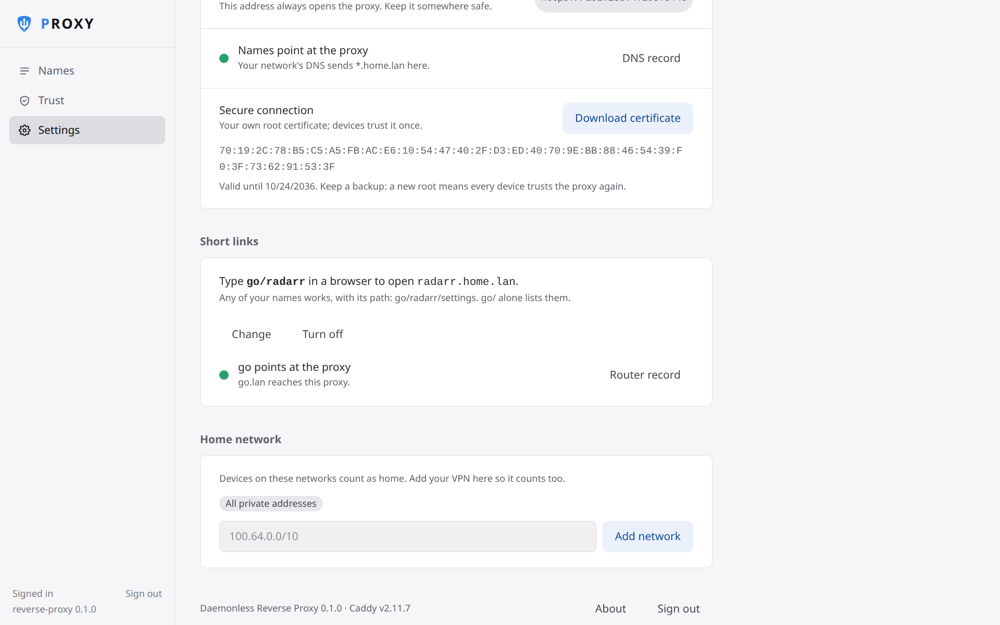

# Backups, operations, and troubleshooting

---

## Backups (`.rpbk`)

Everything needed to rebuild or move Reverse Proxy fits in one `.rpbk` backup archive, optionally encrypted with a passphrase of 8 or more characters.

### Exporting a backup

Open **Settings -> Backup**, enter a passphrase (or leave it blank for an unencrypted `.rpbk`), and click **Download backup**. The archive includes:

- All hostnames, extra names, targets, and access rules (`state.json`)
- Your domain ending, short-link word, listening networks, and alert settings (`state.json`)
- Your admin password hash and connected app keys (`state.json`)
- Saved DNS provider credentials (`secrets/dns.json`)
- Your **internal root CA keypair** (`secrets/ca-root.crt` and `secrets/ca-root.key`), so phones and computers do not have to trust a new certificate after a restore

Minute-by-minute uptime history (`uptime.json`) and custom icons (`icons/`) are left out so the backup stays small.

### Restoring on a fresh install

1. Start a fresh `ghcr.io/daemonless/reverse-proxy:latest` container and open its first-run setup URL (`https://<new-host>:8443/#token=...`).
2. On the **Welcome** screen, click **Restore a backup**.
3. Select your `.rpbk` file, enter its passphrase if encrypted, and click **Restore**.
4. Update your router's wildcard DNS record if the new machine has a different LAN IP.

---

## Uptime checks and alerts

Every configured name (unless turned off) is checked once per minute against its backend target:

- **24-hour status bar:** Shown on every row of the **Names** page.
- **90-day history and outages:** Open any name to view 90-day uptime and outage timestamps.
- **Down and recovery notifications:** Open **Settings -> Uptime and alerts** to send alerts when a service fails two checks in a row and again when it recovers:
    - **[ntfy](https://ntfy.sh):** Topic URL on `ntfy.sh` or your own `ntfy` server
    - **Webhook:** Any `http://` or `https://` URL accepting JSON `POST` payloads

You can turn checks off for an individual name (for example a machine that sleeps overnight) or turn uptime checks off globally under **Settings -> Uptime and alerts**.

---

## Command-line operations

Administrative CLI commands run inside the container and talk to the unprivileged admin process over `/var/run/reverse-proxy/admin.sock`:

| Command | What it does |
| :--- | :--- |
| `podman exec reverse-proxy reverse-proxy hosts` | Lists active and recently removed hostnames, targets, and access scopes. |
| `podman exec reverse-proxy reverse-proxy hosts add <name> <ip>:<port> [--https] [--internet]` | Probes the target and adds a hostname (`home` access by default). |
| `podman exec reverse-proxy reverse-proxy hosts remove <name>` | Soft-deletes a hostname (restorable for 24 hours). |
| `podman exec reverse-proxy reverse-proxy hosts restore <name>` | Restores a soft-deleted hostname within 24 hours. |
| `podman exec reverse-proxy reverse-proxy listen` | Lists attached container networks and marks (`*`) which ones the proxy answers on. |
| `podman exec reverse-proxy reverse-proxy listen <cidr>...` | Restricts the proxy to answering on the given networks (use `listen all` to reset). |
| `podman exec reverse-proxy reverse-proxy reset-password` | Clears a forgotten admin password and prints a new `#token=...` setup link without touching hosts or certificates. |
| `podman exec reverse-proxy reverse-proxy dns-providers` | Prints compiled-in Caddy DNS provider IDs. |

---

## How it works

Reverse Proxy uses the same privilege-separated layout on both operating systems:

- **FreeBSD (`amd64`, `arm64`):** Supervised by `rcd`.
- **Linux (`amd64`, `arm64`):** Built on Linux (Alpine), supervised by `s6`.

Inside the container, processes communicate over Unix sockets in `/var/run/reverse-proxy/`:

1. **`caddy` (`root`):** Runs as `root` so it can bind ports `80` and `443`. Starts from `/etc/reverse-proxy/bootstrap.json` listening on `/var/run/reverse-proxy/caddy.sock` (`persist: false`), serves TLS handshakes via `tls.sock`, and stores issued certificates in `/data`.
2. **`admin` (`bsd`, `PUID`:`PGID`):** Unprivileged Go binary embedding the Svelte UI. Owns `/config`, writes Caddy's full JSON configuration from `/config/state.json`, loads updates atomically over `caddy.sock`, and serves the admin UI and API over `admin.sock`. If Caddy restarts on its own, `admin` reloads its configuration within seconds.
3. **`podman-labels` (`root`):** Watches `/var/run/podman/podman.sock` when mounted and syncs `io.daemonless.proxy*` containers through `admin.sock`. When no socket is mounted, it stays idle.

---

## Troubleshooting

### I cannot open `https://<host>:8443` from the host machine itself (FreeBSD)
On FreeBSD without `net.pf.filter_local=1` enabled before `pf` starts, the host cannot reach its own published Podman ports. Open the setup link from another computer or phone on your network, or configure local `pf` filtering as shown in the [Networking guide](../guides/networking.md#pfconf-setup).

### Permission denied on `/config`, `/data`, or `podman.sock` on Fedora or RHEL
SELinux blocks container access to bind-mounted folders and Podman's socket unless exempted. Keep `security_opt: [label=disable]` in `compose.yaml` (or pass `--security-opt label=disable` to `podman run`).

### Certificate banner shows an error on the Names page
The Names page reads Caddy's log and explains ACME and DNS errors in plain words, such as a rejected token, a Porkbun domain with API access switched off on its details page, or a rate limit. Replace the token under **Settings -> Ending and certificates**.

### Typing `go/radarr` searches the web instead of opening Radarr
Check that you added the optional `go` record on your router pointing at the proxy's LAN IP. The first time in Safari or Firefox, type **`http://go/radarr`** with `http://` so the browser learns `go` is a host on your network.

### An Android app refuses to connect with *Just for home* certificates
Browsers on Android trust the proxy once you install the CA certificate, but some apps ignore certificates you install yourself; if an app refuses to connect, that is why. Switch **Settings -> Ending and certificates** to **DuckDNS** or **Your own domain** if you need every app to use a Let's Encrypt certificate that Android trusts by default.

### Deleting `/data` or `/config`
- Keep **`/data`** on persistent storage: deleting `/data` discards the certificates Caddy issued, forcing Caddy to request them again from Let's Encrypt.
- Keep **`/config`** backed up via **Settings -> Backup**: losing `/config` without a backup loses your root certificate and DNS token, and every device using *Just for home* would have to trust the proxy again.
