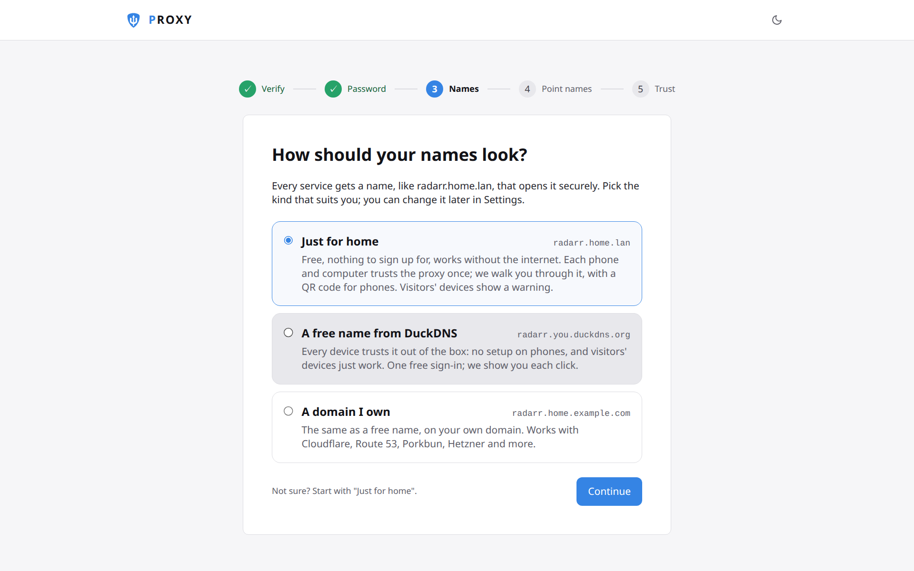
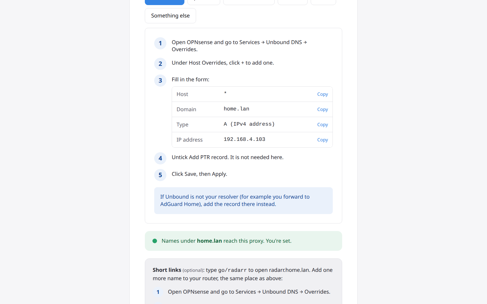
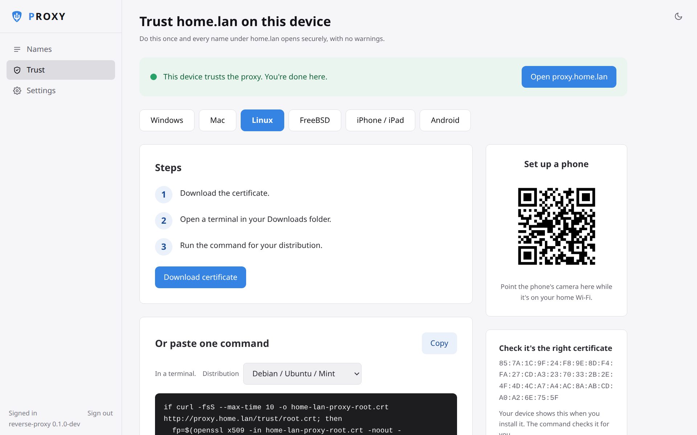

# Host and first-run setup

Daemonless Reverse Proxy ships as a single container (`ghcr.io/daemonless/reverse-proxy:latest`) for **FreeBSD (`amd64`, `arm64`)** and **Linux (`amd64`, `arm64`)**. Start the container, open the one-time setup link from its log, and complete setup in your browser, with no Caddyfiles or YAML routes to write.

---

## 1. Before you start

The proxy listens on three ports:

| Port | Protocol | Purpose |
| :--- | :--- | :--- |
| `80` | HTTP | Redirects browsers to HTTPS and serves the `/trust` certificate download page |
| `443` | HTTPS | Serves your named applications |
| `8443` | HTTPS | Serves the Reverse Proxy admin UI and REST API before setup completes (and `https://proxy.<your domain>` afterward) |

Make sure nothing else on the host is bound to TCP ports `80`, `443`, or `8443`.

=== "FreeBSD (`amd64` · `arm64`)"

    1. **`pf` port forwarding:** Podman's bridge network on FreeBSD needs the `pf` rules in the [Networking guide](../guides/networking.md#pfconf-setup) before ports `80`, `443`, and `8443` answer.
    2. **Auto-start at boot:** Keep `restart: always` in `compose.yaml`. FreeBSD's `podman` rc.d script only auto-starts containers with `restart: always` at boot when `podman_enable=YES` is set.
    3. **Reaching published ports from the host:** Without `net.pf.filter_local=1` enabled before `pf` starts, a FreeBSD host cannot reach its own published container ports. Open `https://<host-lan-ip>:8443` from another device on your network, or configure `net.pf.filter_local=1` as shown in the [Networking guide](../guides/networking.md#pfconf-setup).

=== "Linux (`amd64` · `arm64`)"

    1. **Binding ports `80` and `443`:** Run with rootful **Podman** so Caddy can bind ports `80` and `443`.
    2. **SELinux hosts (Fedora, RHEL):** Keep `security_opt: [label=disable]` in `compose.yaml` (or `--security-opt label=disable` on the CLI). It lets the proxy use its mounted folders and, when enabled, Podman's socket; hosts without SELinux ignore it.

---

## 2. Deploy the container

Choose whichever deployment workflow fits your host:

=== "fjord"

    1. Open **fjord** (`http://<host>:3567`), go to the **App Store**, and select **Reverse Proxy**.
    2. Optionally switch **Name containers by their labels** to **On** if you also want Podman containers on the same host with `io.daemonless.proxy=true` to get names here.
    3. Click **Install**.

    fjord generates `RP_PAIRING_KEY` and `RP_SETUP_TOKEN` automatically. Once the stack is running, click **Finish setup** on the Reverse Proxy row; your browser opens setup already verified.

=== "Podman Compose"

    Download or copy `compose.yaml` from the [Reverse Proxy image page](../images/reverse-proxy.md), where you can also toggle container-label socket access, then start the stack and read the setup link from its log:

    ```sh { linenums="0" }
    podman-compose up -d
    podman logs reverse-proxy
    ```

=== "Podman CLI"

    ```sh { linenums="0" }
    podman run -d --name reverse-proxy \
      --restart=always \
      --security-opt label=disable \
      -p 80:80 -p 443:443 -p 8443:8443 \
      -e PUID=1000 -e PGID=1000 -e TZ=UTC \
      -v /path/to/containers/reverse-proxy:/config \
      -v /path/to/containers/reverse-proxy/data:/data \
      ghcr.io/daemonless/reverse-proxy:latest

    podman logs reverse-proxy
    ```

### Volumes and environment variables

| Name | Default | What it does |
| :--- | :--- | :--- |
| `/config` | *(required volume)* | Admin state (`state.json`), uptime history (`uptime.json`), icons, and `secrets/` (internal root CA key, DNS credentials). Owned by `bsd` (`PUID`:`PGID`). |
| `/data` | *(required volume)* | Certificates issued by Caddy, ACME account keys, and internal CA state. Owned by `root`. Keep both `/config` and `/data` across container upgrades. |
| `PUID` / `PGID` | `1000` / `1000` | User and group ID for the unprivileged admin process (web UI and API). Caddy stays `root` to bind ports `80` and `443`. |
| `TZ` | `UTC` | Container timezone. |
| `RP_ADMIN_URL` | *(remembered after sign-in)* | External URL where you open the admin UI, e.g. `https://192.168.1.5:8443`. Optional: makes the first-run link in the log exact before anyone has signed in. |
| `RP_TRUST_PORT` | `80` | Host port mapped to container port `80` if you publish the HTTP trust page on something other than `80`, so QR codes and commands on `/trust` use it. |
| `RP_LISTEN` | *(all networks)* | Space- or comma-separated subnets or interfaces the proxy answers on, overriding the choice in `Settings -> Home network`. |
| `RP_DEBUG` | *(off)* | Set to `1` for Caddy's full `INFO`-level log; off by default so the log stays readable. |

---

## 3. First-run browser setup

On first boot, `podman logs reverse-proxy` prints a one-time setup banner:

```text { linenums="0" }
[admin]
[admin] First run. Set up at port 8443 of this machine, over https:
[admin]
[admin]     https://<this machine>:8443/#token=XXXX-XXXX-XXXX-XXXX
[admin]
[admin] Without the link, the page asks for the setup token: XXXX-XXXX-XXXX-XXXX
[admin] RP_ADMIN_URL in the compose makes this link exact.
[admin]
```

Replace `<this machine>` with your server's LAN IP, such as `https://192.168.1.5:8443/#token=...`, and open it in a browser.

!!! info "Why the browser warns once on `:8443`"
    Before setup finishes, the proxy does not know your domain yet, so `:8443` uses a self-issued certificate. Accept the one-time browser warning to enter setup. The `#token=...` part is a URL fragment, which browsers never send over the network, so the setup token cannot land in any HTTP log. After setup finishes, the admin lives at `https://proxy.<your domain>` with a certificate your devices trust.



The setup wizard walks through these steps, and each setting can be changed later under **Settings**:

### Step 1: Welcome or restore a backup

- Opening the `#token=` link verifies your session automatically (**Verified from your link**). If you opened `https://<ip>:8443` without the link, paste the setup token from `podman logs reverse-proxy`, or open setup from fjord if fjord installed the proxy.
- Moving from another machine? Click **Restore a backup** on the Welcome screen, select your `.rpbk` file, enter its passphrase if you set one, and click **Restore**. Names, settings, DNS tokens, and your root CA return at once.

### Step 2: Choose an admin password

Set the password for the Reverse Proxy admin UI. Passwords are checked locally and stored hashed on disk. If you forget it later, run `podman exec reverse-proxy reverse-proxy reset-password` on the host to print a new setup link without losing your names or certificates.

### Step 3: Home network (multi-VLAN hosts only)

When the container is on **more than one network**, such as when fjord attaches VLAN interfaces so the proxy can reach apps across VLANs, setup asks which networks are **home**:

- **Ticked networks** can open the admin UI and your home-only names.
- **Unticked networks** get no answer at all, and their devices are never treated as home whatever your router does, while the proxy still reaches apps running on them.
- The network your browser is connecting from stays ticked so you cannot lock yourself out.

### Step 4: How names should look

Pick one of three ways to name services on your network:

1. **Just for home** (`apps.lan`, `home.arpa`, `home.lan`): free, works without the internet, and creates a root certificate restricted to that ending.
2. **A free name from DuckDNS** (`radarr.you.duckdns.org`): walks you through signing in at `duckdns.org`, adding a subdomain, and pasting your 36-character token. Obtains a Let's Encrypt wildcard certificate that every device already trusts.
3. **Your own domain** (`radarr.example.com` or `radarr.home.example.com`): looks up where your domain's DNS is hosted, pre-selects your DNS provider (**Cloudflare, Route 53, DuckDNS, deSEC, Porkbun, Hetzner, OVH, Gandi, My own DNS server (RFC 2136), or acme-dns**), tests your token on Let's Encrypt's staging service first, and gets one wildcard certificate for every name under it.

See [Certificates, DNS, and access control](certificates-and-access.md) for the API token permissions each DNS provider requires.

---

## 4. Point names at the proxy

Devices on your home network need `*.<your domain>` to resolve to the **LAN IP of the host running Reverse Proxy**.



Pick your router or DNS server in setup to get the values for your domain and IP. The page checks DNS automatically and turns **green** when queries reach the proxy:

=== "OPNsense (Unbound)"

    1. Open OPNsense and go to **Services -> Unbound DNS -> Overrides**.
    2. Under **Host Overrides**, click **+** to add one:
        - **Host:** `*`
        - **Domain:** `<your domain>`
        - **Type:** `A (IPv4 address)`
        - **IP address:** `<proxy LAN IP>`
    3. Untick **Add PTR record**, click **Save**, then **Apply**.

    If Unbound is not your resolver (for example you forward to AdGuard Home), add the record there instead.

=== "pfSense (Unbound)"

    pfSense's Host Overrides form cannot take a wildcard, so the record goes in Unbound's custom options:

    1. Open pfSense and go to **Services -> DNS Resolver -> General Settings**.
    2. Click **Display Custom Options** at the bottom and paste the lines from the wizard:

    ```text { linenums="0" }
    server:
      local-zone: "home.lan" redirect
      local-data: "home.lan A 192.168.1.5"
    ```

    3. Save, then click **Apply Changes**.

=== "AdGuard Home"

    1. Open AdGuard Home and go to **Filters -> DNS rewrites**.
    2. Click **Add DNS rewrite**:
        - **Domain:** `*.<your domain>`
        - **Answer:** `<proxy LAN IP>`
    3. Save.

=== "Pi-hole"

    Pi-hole's Local DNS Records form cannot take a wildcard, so create `/etc/dnsmasq.d/99-reverse-proxy.conf` on the Pi-hole machine:

    ```sh { linenums="0" }
    echo "address=/home.lan/192.168.1.5" | sudo tee /etc/dnsmasq.d/99-reverse-proxy.conf
    pihole restartdns
    ```

    !!! warning "Pi-hole 6"
        Pi-hole 6 ignores `/etc/dnsmasq.d` until you turn on **`misc.etc_dnsmasq_d`** in **Settings -> All settings** (expert mode).

=== "UniFi"

    1. Open the UniFi Network app and look for **Local DNS Records** (recent versions: **Settings -> Routing -> DNS**; older: under Networks or the Policy Table).
    2. Add a record: **Domain** `*.<your domain>` pointing at `<proxy LAN IP>`.
    3. If your version refuses a wildcard (`*`), add two records for now, `proxy.<your domain>` and the first host you create, both pointing at `<proxy LAN IP>`.

    If your UniFi gateway forwards DNS to another server (AdGuard Home, Pi-hole), add the record there instead.

### Optional: enable `go/radarr` short links

On the same DNS step, setup offers one optional `A` record (`go` under your network's local domain, such as `go.lan` pointing at `<proxy LAN IP>`). Once added:

- Typing **`go/radarr`** in a browser opens `https://radarr.<your domain>`, keeping any path after it.
- Typing **`go/`** opens the proxy's Names page.
- The first time in Safari or Firefox, type `http://go/radarr` with `http://`, or the browser will search the web for it instead.

---

## 5. Trust the proxy on your devices (*Just for home* only)

If you chose **DuckDNS** or **Your own domain**, Let's Encrypt certificates are already trusted by every device, and setup goes straight to **Done**.

If you chose **Just for home**, each device trusts the proxy's root certificate once. You can reopen these steps anytime at `http://proxy.<your domain>/trust` or `https://proxy.<your domain>/trust`, including a QR code for phones:



Every command block on `/trust` checks the certificate's **SHA-256** fingerprint before installing it, so a modified download over plain HTTP installs nothing:

- **iPhone / iPad:** Scan the QR code in **Safari** -> tap **Download certificate** (*Allow*, then *Close*) -> open **Settings -> Profile Downloaded -> Install** -> back in **Settings**, go to **General -> About -> Certificate Trust Settings** and switch on the proxy root. Step 3 is the one people miss: installing the profile is not enough on its own.
- **Android:** Scan the QR code -> tap **Download certificate** -> open **Settings -> Security (or Security & privacy) -> More security settings -> Encryption & credentials -> Install a certificate -> CA certificate** -> tap **Install anyway** and choose the downloaded file.
- **Windows:** Run the PowerShell command from `/trust` in an Administrator PowerShell window (checks SHA-256 and imports into `Cert:\LocalMachine\Root`), or open the downloaded file -> **Install Certificate -> Local Machine -> Trusted Root Certification Authorities**.
- **Mac:** Run the Terminal command on `/trust` (`sudo security add-trusted-cert -d -r trustRoot -k /Library/Keychains/System.keychain ...`), or double-click the certificate in Keychain Access and set **When using this certificate** to **Always Trust**.
- **Linux:** Run the `/trust` command for **Debian/Ubuntu** (`update-ca-certificates`), **Fedora/RHEL** (`update-ca-trust`), or **Arch** (`trust anchor --store`). Chrome and Chromium on Linux keep their own store; `/trust` shows the `certutil -d sql:$HOME/.pki/nssdb` command for them.
- **FreeBSD:** Run the `/trust` command (`cp ... /usr/local/share/certs/ && certctl rehash`, using `root`, `doas`, or `sudo`).
- **Firefox:** Open **Settings -> Privacy & Security -> Certificates -> View Certificates -> Authorities -> Import**, select the downloaded file, and tick **Trust this CA to identify websites**.

---

## 6. Add your first name

Once setup finishes, open `https://proxy.<your domain>`:

1. If you installed from **fjord** or turned on **Names from container labels**, your apps are already listed or named.
2. To add a service by hand, click **Add a name**, type the name (such as `radarr`), and paste the address you open today (such as `192.168.1.20:7878`).
3. Reverse Proxy checks whether the target speaks HTTP or HTTPS, accepts self-signed upstream certificates when needed, issues its HTTPS certificate, and starts 1-minute uptime checks.
